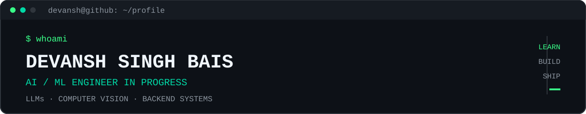

<div align="center">



<br/>

<a href="https://github.com/DevanshSinghBais"></a>
<a href="https://www.linkedin.com/in/devansh-singh-bais-748b192b5/"></a>
<a href="mailto:devanshsinghbais111@gmail.com"></a>

</div>

```text
┌─[ devansh@github ]─[ ~/profile ]──────────────────────────────────────────────┐
│ $ ./boot.sh                                                                  │
│                                                                              │
│ [OK] loading identity                                                       │
│ [OK] loading AI / ML stack                                                  │
│ [OK] loading computer-vision modules                                       │
│ [OK] loading LLM + agent tooling                                            │
│ [OK] loading backend systems                                                │
│                                                                              │
│ mission: turn models + data + tools into useful software                    │
│ mode:    learn → build → ship                                               │
└──────────────────────────────────────────────────────────────────────────────┘
```

## `01 / SYSTEM.INFO`

<table width="100%">
<tr>
<td width="55%" valign="top">

```text
$ cat /etc/identity

NAME       Devansh Singh Bais
ROLE       AI / ML Engineer · Student
EDUCATION  B.Tech CSE @ MANIT Bhopal
FOCUS      LLMs · Computer Vision · Backend
MODE       building systems, not just demos
```

</td>
<td width="45%" valign="top">

```text
$ cat /etc/principles

01  understand the model
02  build the system around it
03  expose useful tools
04  handle failure modes
05  ship something usable
```

</td>
</tr>
</table>

---

## `02 / STACK`

```text
$ tree /etc/stack --depth=2
```

<table width="100%">
<tr>
<td width="25%" valign="top">

### `LANGUAGES`

`C++` · `Python`  
`C` · `Java`  
`JavaScript` · `TypeScript`  
`SQL` · `HTML` · `CSS`

</td>
<td width="25%" valign="top">

### `AI / ML`

`PyTorch`  
`TensorFlow` · `Keras`  
`scikit-learn`  
`NumPy` · `Pandas`  
`Matplotlib`

</td>
<td width="25%" valign="top">

### `VISION`

`OpenCV`  
`YOLO / YOLOv8`  
`ByteTrack`  
`Image Classification`  
`Real-time Inference`

</td>
<td width="25%" valign="top">

### `LLM SYSTEMS`

`Hugging Face`  
`Transformers`  
`RAG` · `Vector DBs`  
`Function Calling`  
`Agentic AI` · `MCP`

</td>
</tr>
<tr>
<td width="25%" valign="top">

### `BACKEND`

`Node.js` · `Express`  
`REST APIs`  
`PostgreSQL`  
`MongoDB` · `Redis`

</td>
<td width="25%" valign="top">

### `WEB`

`React`  
`TypeScript`  
`Next.js`  
`Vite`  
`Gradio`

</td>
<td width="25%" valign="top">

### `DEV / INFRA`

`Git` · `GitHub`  
`Docker` · `Linux`  
`Jupyter`  
`GitHub Actions`

</td>
<td width="25%" valign="top">

### `ENGINEERING`

`APIs` · `Data Pipelines`  
`Model Deployment`  
`AI Deployment`  
`Production AI Systems`

</td>
</tr>
</table>

<div align="center">


</div>

---

## `03 / SYSTEMS`

```text
$ ls -la ./projects
```

<table width="100%">
<tr>
<td width="50%" valign="top">

### `01 // FLAGSHIP`

# 🛡️ CrowdShield AI

**Observe → Understand → Predict → Simulate → Recommend → Optimize**

AI-powered crowd monitoring and management using computer vision, multi-camera processing, tracking, risk analysis and operational recommendations.

`YOLOv8` `ByteTrack` `OpenCV` `Node.js` `Express` `MongoDB` `React` `Docker`

**[↗ VIEW REPOSITORY](https://github.com/DevanshSinghBais/CrowdSheild_Hackathon)**

</td>
<td width="50%" valign="top">

### `02 // ENVIRONMENTAL INTELLIGENCE`

# 🌍 EcoMRI

Turns environmental observations into anomaly investigations, spatial context, evidence and recommended action.

`TypeScript` `React` `tRPC` `Express` `Drizzle` `Maps`

**[↗ REPOSITORY](https://github.com/DevanshSinghBais/ecomri)** · **[↗ LIVE](https://ecomri-gsy3klvs.manus.space)**

</td>
</tr>
<tr>
<td width="50%" valign="top">

### `03 // AGENT SYSTEM`

# 🧠 StudyPilot

Tool-using AI learning agent with function calling, knowledge search, study planning, quiz generation, calculations and data analysis.

`Python` `LLM API` `Function Calling` `Gradio` `NumPy`

**[↗ VIEW REPOSITORY](https://github.com/DevanshSinghBais/StudyPilot)**

</td>
<td width="50%" valign="top">

### `04 // DEVELOPER TOOLING`

# 🔎 GitHub Repo Explainer

Uses the GitHub REST API and Gemini to turn repository documentation into beginner-friendly explanations.

`Python` `Gemini` `GitHub API` `Jupyter`

**[↗ VIEW REPOSITORY](https://github.com/DevanshSinghBais/GitHub-Repo-Explainer)**

</td>
</tr>
<tr>
<td width="50%" valign="top">

### `05 // COMPUTER VISION / ML`

# 🩻 Pneumonia Detection

Chest X-ray classification experiment exploring neural-network based medical image classification.

`Python` `TensorFlow` `OpenCV` `NumPy` `scikit-learn`

**[↗ VIEW REPOSITORY](https://github.com/DevanshSinghBais/Pneumonia_Detection)**

</td>
<td width="50%" valign="top">

### `06 // TIME SERIES`

# 📈 TSLA LSTM Forecasting

Sequence-modeling experiment using rolling windows, scaling and LSTM forecasting.

`Python` `TensorFlow` `LSTM` `Pandas` `scikit-learn`

**[↗ VIEW REPOSITORY](https://github.com/DevanshSinghBais/TSLA-LSTM-Forecasting)**

</td>
</tr>
</table>

---

## `04 / GITHUB.TELEMETRY`

```text
$ git log --profile --stats
```

<div align="center">


<br/>


</div>

<div align="center">


</div>

---

## `05 / CONTRIBUTION.MATRIX`

```text
$ watch --color=green github-contributions
```

<div align="center">

</div>

---

## `06 / CURRENTLY.RUNNING`

```text
$ ps aux | grep devansh

PID     PROCESS                                  STATUS
----    ---------------------------------------  --------
001     agentic-ai / tool-using LLMs             RUNNING
002     computer-vision / real-time inference    RUNNING
003     RAG / vector retrieval / MCP             RUNNING
004     backend / production AI systems           RUNNING
005     hackathons / open-source                  RUNNING
```

<table width="100%">
<tr>
<td width="33%" valign="top"><strong>LEARN</strong><br/><code>PyTorch</code> · <code>LLMs</code> · <code>Agents</code></td>
<td width="33%" valign="top"><strong>BUILD</strong><br/><code>CV</code> · <code>RAG</code> · <code>Backend</code></td>
<td width="33%" valign="top"><strong>SHIP</strong><br/><code>Docker</code> · <code>APIs</code> · <code>AI Deployment</code></td>
</tr>
</table>

---

## `07 / EDUCATION`

```text
$ cat /etc/education

MANIT Bhopal
B.Tech — Computer Science & Engineering
2025 — 2029

focus :: machine learning · systems · software engineering · AI
```

---

## `08 / CONNECT`

```text
$ ./connect.sh

[01] GitHub     → github.com/DevanshSinghBais
[02] LinkedIn   → linkedin.com/in/devansh-singh-bais-748b192b5
[03] Email      → devanshsinghbais111@gmail.com
```

<div align="center">

<a href="https://github.com/DevanshSinghBais">GitHub ↗</a> ·
<a href="https://www.linkedin.com/in/devansh-singh-bais-748b192b5/">LinkedIn ↗</a> ·
<a href="mailto:devanshsinghbais111@gmail.com">Email ↗</a>

</div>

```text
┌─[ devansh@github ]───────────────────────────────────────────────────────────┐
│ $ echo "Build systems, not just demos."                                     │
│                                                                              │
│ Build. Learn. Ship. Repeat.                                                 │
│                                                                              │
│ devansh@github:~$ █                                                          │
└──────────────────────────────────────────────────────────────────────────────┘
```

<div align="center"><sub>Terminal session terminated successfully.</sub></div>
