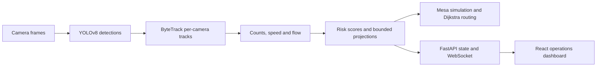

<p align="center">
  
</p>

<p align="center">
  <a href="https://github.com/DevanshSinghBais">GitHub</a> ·
  <a href="https://www.linkedin.com/in/devansh-singh-bais-748b192b5/">LinkedIn</a> ·
  <a href="mailto:devanshsinghbais111@gmail.com">Email</a>
</p>

```text
devansh@github:~$ whoami
AI/ML engineer in progress · B.Tech CSE, MANIT Bhopal
building practical AI tools, vision systems, and backend applications
```

## About

I like turning models and data into useful software. My project work spans deep learning, computer vision, LLM-powered tools, and the APIs and interfaces around them. I’m especially interested in reliable inference workflows and clear boundaries between a prototype and a production system.

### Current focus

- Building with LLMs, tool use, and retrieval workflows.
- Improving computer-vision inference and multi-object tracking.
- Learning to design maintainable APIs and AI-backed systems.

## Stack

The first group reflects technologies visible in inspected projects and repository configuration. The second is a learning and exploration list, not a claim of mastery.

**Used in project work**

- **Languages and web:** `Python` · `JavaScript` · `TypeScript` · `SQL` · `HTML` · `CSS`
- **ML and vision:** `TensorFlow` · `NumPy` · `Pandas` · `Scikit-learn` · `OpenCV` · `YOLO` · `YOLOv8` · `ByteTrack`
- **LLM and backend:** `Gemini API` · `Node.js` · `Express.js` · `REST APIs` · `API integration` · `React`
- **Data and tools:** `PostgreSQL` · `MongoDB` · `Git` · `GitHub` · `Docker` · `Linux` · `Jupyter Notebook` · `Visual Studio Code` · `GitHub Actions`

**Learning and exploring**

- **Languages and ML:** `C++` · `C` · `Java` · `PyTorch` · `Transformers`
- **LLMs:** `Hugging Face` · `Large Language Models (LLMs)` · `Generative AI` · `OpenAI API` · `prompt engineering` · `Retrieval-Augmented Generation (RAG)` · `embeddings` · `vector databases` · `agentic AI` · `AI agents`
- **Systems:** `Redis` · `backend architecture` · `AI deployment` · `model inference` · `model evaluation` · `production-oriented AI systems` · `computer vision pipelines` · `data processing` · `real-time detection pipelines`

## Featured projects

### CrowdShield AI · Team QBurn

Crowd monitoring prototype that combines camera-based detections and tracking with risk signals, short-term projections, simulations, and route recommendations. It uses YOLOv8 and ByteTrack for per-camera tracking, derives movement and line-crossing flow signals, and applies weighted risk inputs. Its 10/20/30-minute projections are bounded slope heuristics; simulation and Dijkstra routing use a demo map, not validated venue-safety measurements.

`Python` · `OpenCV` · `YOLOv8` · `ByteTrack` · `Mesa` · `NetworkX` · `FastAPI` · `React` · `TypeScript`

[Repository](https://github.com/DevanshSinghBais/CrowdSheild_AI) · [SISTec Innovation Hackathon](https://www.sistecrsih.in/explore) · [team recap](https://in.linkedin.com/in/siddharth-tomar-1b2502325)

**Achievement:** Team QBurn (styled `QYBurn` in the participant recap) won the SISTec Bhopal Hackathon 2026. CrowdShield’s demo data and risk assumptions are illustrative; see the repository documentation for scope and limitations.

The CrowdShield flow, at a glance:



See the official event details and participant recap above.

### EcoMRI

Environmental monitoring prototype with station maps, anomaly views, trends, and recommendations. Its README identifies the displayed environmental values and recommendations as simulated.

`TypeScript` · `React` · `Node.js` · `Express` · `tRPC` · `Drizzle`

[Repository](https://github.com/DevanshSinghBais/ecomri)

### StudyPilot

Learning assistant prototype with LLM function calling, local knowledge search, study planning, quizzes, calculations, and basic data analysis. RAG and a production backend are listed as roadmap work in its repository.

`Python` · `LLM API` · `Gradio`

[Repository](https://github.com/DevanshSinghBais/StudyPilot)

### GitHub Repo Explainer

Fetches repository documentation through the GitHub REST API and uses Gemini to stream a beginner-friendly explanation.

`Python` · `GitHub REST API` · `Gemini API` · `Jupyter Notebook`

[Repository](https://github.com/DevanshSinghBais/GitHub-Repo-Explainer)

### More experiments

- [Pneumonia Detection](https://github.com/DevanshSinghBais/Pneumonia_Detection) — a TensorFlow/Keras dense neural-network experiment on flattened 128×128 grayscale chest X-rays; the repository reports no validated performance claim.
- [TSLA LSTM Forecasting](https://github.com/DevanshSinghBais/TSLA-LSTM-Forecasting) — an LSTM exercise that uses historical Tesla closing prices to estimate a next-day close; it does not establish investment or forecasting performance.

## GitHub activity

<p>
  <a href="https://github.com/anuraghazra/github-readme-stats">
    
  </a>
  <a href="https://github.com/anuraghazra/github-readme-stats">
    
  </a>
</p>

GitHub’s native contribution graph remains available on the [profile overview](https://github.com/DevanshSinghBais). Statistics cards depend on the public GitHub Readme Stats service; they may be unavailable or rate-limited. A contribution-streak card is omitted until its endpoint can be relied on.

### Contribution snake


The snake is generated daily by [`.github/workflows/snake.yml`](./.github/workflows/snake.yml) and published to the `output` branch. If the image is missing, the workflow has not yet completed successfully or repository Actions permissions need attention; see [maintenance notes](./PROFILE_MAINTENANCE.md).

## Education and contact

**B.Tech, Computer Science and Engineering · MANIT Bhopal**

For professional contact, email [devanshsinghbais111@gmail.com](mailto:devanshsinghbais111@gmail.com), or connect on [LinkedIn](https://www.linkedin.com/in/devansh-singh-bais-748b192b5/). The profile README is maintained in the [DevanshSinghBais repository](https://github.com/DevanshSinghBais/DevanshSinghBais).

## Open-source contributions

<!-- OSS_START -->
Automatically updated by GitHub Actions from public pull requests authored by this account.
<!-- OSS_END -->

<p align="center"><sub>Build carefully. Ship useful things.</sub></p>
