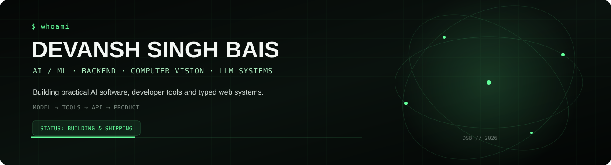

<div align="center">



<br/>

<a href="https://github.com/DevanshSinghBais"></a>
<a href="https://www.linkedin.com/in/devansh-singh-bais-748b192b5/"></a>
<a href="mailto:devanshsinghbais111@gmail.com"></a>

</div>

<br/>

## `01 / PROFILE`

I’m a **B.Tech CSE student at MANIT Bhopal** building practical software around **AI/ML, LLM applications, computer vision and backend systems**.

I care less about adding buzzwords and more about turning models into something people can actually use.

```text
IDEA
  ↓
MODEL / ALGORITHM
  ↓
TOOLS + DATA
  ↓
TYPED API
  ↓
PRODUCT
```

---

## `02 / SELECTED WORK`

<table>
<tr>
<td width="50%" valign="top">

### 🛡️ CrowdShield AI
**AI-powered crowd monitoring & management**

A computer-vision system built around multi-camera observation, detection/tracking, risk analysis and operational recommendations.

**Stack:** `YOLOv8` `ByteTrack` `OpenCV` `Node.js` `Express` `MongoDB` `React` `Docker`

<a href="https://github.com/DevanshSinghBais/CrowdSheild_Hackathon">Repository ↗</a>

</td>
<td width="50%" valign="top">

### 🌍 EcoMRI
**Environmental intelligence platform**

Turns environmental observations into anomaly investigations, spatial context, evidence and recommended action through a typed web stack.

**Stack:** `TypeScript` `React` `tRPC` `Express` `Drizzle`

<a href="https://github.com/DevanshSinghBais/ecomri">Repository ↗</a> · <a href="https://ecomri-gsy3klvs.manus.space">Live ↗</a>

</td>
</tr>
<tr>
<td width="50%" valign="top">

### 🧠 StudyPilot
**Tool-using AI learning agent**

An LLM workflow that routes requests to concrete tools for calculations, note search, study plans, quizzes and data analysis.

**Stack:** `Python` `LLM API` `Function Calling` `Gradio` `NumPy`

<a href="https://github.com/DevanshSinghBais/StudyPilot">Repository ↗</a>

</td>
<td width="50%" valign="top">

### 🔎 GitHub Repo Explainer
**AI developer tooling**

Fetches a repository README through the GitHub REST API and uses Gemini to turn unfamiliar project documentation into a beginner-friendly explanation.

**Stack:** `Python` `GitHub REST API` `Gemini` `Jupyter`

<a href="https://github.com/DevanshSinghBais/GitHub-Repo-Explainer">Repository ↗</a>

</td>
</tr>
</table>

---

## `03 / ENGINEERING STACK`

| Area | Technologies |
|---|---|
| **Languages** | `C++` `Python` `TypeScript` `JavaScript` `C` `Java` |
| **AI / ML** | `PyTorch` `TensorFlow` `scikit-learn` `OpenCV` `YOLO` |
| **LLM Systems** | `Hugging Face` `RAG` `Vector DBs` `Prompt Engineering` `Agentic AI` `MCP` |
| **Backend** | `Node.js` `Express` `PostgreSQL` `MongoDB` `Redis` |
| **Frontend** | `React` `HTML` `CSS` |
| **Infrastructure** | `Docker` `Linux` `Git` `GitHub Actions` |

---

## `04 / GITHUB SIGNAL`

<div align="center">


<br/>

</div>

<br/>

<div align="center"></div>

---

## `05 / CURRENTLY BUILDING`

**AI systems that are useful outside the notebook.**

- tool-using LLM workflows
- production-oriented AI backends
- computer-vision pipelines
- RAG and agentic systems
- turning prototypes into deployable products

---

## `06 / PRINCIPLE`

> **A model call is easy to make. A useful system makes its inputs, tools, failure modes and limits clear.**

---

## `07 / CONNECT`

<div align="center">
<a href="https://github.com/DevanshSinghBais">GitHub</a> · <a href="https://www.linkedin.com/in/devansh-singh-bais-748b192b5/">LinkedIn</a> · <a href="mailto:devanshsinghbais111@gmail.com">Email</a>
<br/><br/>
<sub>B.Tech. Computer Science & Engineering · MANIT Bhopal · 2025–2029</sub>
</div>
