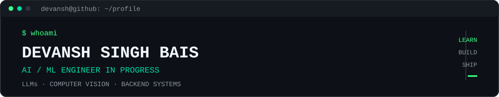

<p align="center">
  
</p>

<p align="center">
  <a href="https://github.com/DevanshSinghBais">GitHub</a> ·
  <a href="https://www.linkedin.com/in/devansh-singh-bais-748b192b5/">LinkedIn</a> ·
  <a href="mailto:devanshsinghbais111@gmail.com">Email</a>
</p>

<p align="center">
  
</p>

```text
devansh@github:~$ whoami

AI/ML engineer in progress · B.Tech CSE, MANIT Bhopal

Building practical AI systems, intelligent applications,
computer vision pipelines and scalable backend services.
```

---

## `$ about --me`

I enjoy turning models, algorithms and data into useful software.

My interests span **Machine Learning, Deep Learning, Computer Vision, LLMs and Backend Engineering**. I like understanding how things work beneath the abstractions, experimenting with architectures and building systems that go beyond isolated notebooks.

Currently focused on:

* Building with LLMs, tool calling and retrieval workflows.
* Understanding neural networks and deep learning architectures.
* Developing computer vision systems with detection and tracking.
* Designing maintainable APIs and AI-backed applications.
* Exploring the intersection of AI research and practical engineering.

---

## `$ tech-stack`

Technologies I've worked with and technologies I'm actively exploring.

### Languages

<p>
  
</p>

### Machine Learning & Computer Vision

<p>
  
  
  
  
  
  
</p>

### LLMs & Generative AI

<p>
  
  
  
  
  
  
  
  
  
</p>

### Backend & Databases

<p>
  
  
  
</p>

### Development & Infrastructure

<p>
  
</p>

---

## `$ projects --featured`

### 01. CrowdShield AI

**AI-powered crowd monitoring and risk intelligence platform**

An intelligent crowd-management prototype combining real-time person detection, multi-object tracking, crowd-flow analysis, risk scoring, short-term projections and route recommendations.

**Core implementation:**

* YOLOv8 for person detection.
* ByteTrack for multi-object tracking.
* Crowd density, movement speed and line-crossing analysis.
* Weighted risk scoring and 10/20/30-minute projections.
* Mesa-based agent simulation and Dijkstra route planning.
* FastAPI backend with a React operations dashboard.

`Python` `OpenCV` `YOLOv8` `ByteTrack` `Mesa` `NetworkX` `FastAPI` `React` `TypeScript`

[Repository](https://github.com/DevanshSinghBais/CrowdSheild_AI) · [SISTec Innovation Hackathon](https://www.sistecrsih.in/explore)

**Achievement:** Team QBurn won the SISTec Bhopal Hackathon 2026.

*Note: Risk assumptions, projections and simulation outputs are prototype-level, not validated venue-safety measurements.*

---

### 02. EcoMRI

**Environmental monitoring and intelligence platform**

An environmental monitoring prototype featuring station maps, anomaly views, trend analysis and recommendations.

`TypeScript` `React` `Node.js` `Express` `tRPC` `Drizzle`

[Repository](https://github.com/DevanshSinghBais/ecomri)

---

### 03. StudyPilot

**AI-powered learning assistant**

A learning assistant prototype incorporating LLM function calling, local knowledge search, study planning, quizzes, calculations and basic data analysis.

`Python` `LLM APIs` `Gradio`

[Repository](https://github.com/DevanshSinghBais/StudyPilot)

---

### 04. GitHub Repo Explainer

**Making unfamiliar repositories easier to understand**

Fetches repository documentation using the GitHub REST API and uses Gemini to generate beginner-friendly explanations.

`Python` `GitHub REST API` `Gemini API` `Jupyter Notebook`

[Repository](https://github.com/DevanshSinghBais/GitHub-Repo-Explainer)

---

### More experiments

| Project                                                                            | Description                                     | Technologies      |
| ---------------------------------------------------------------------------------- | ----------------------------------------------- | ----------------- |
| [Pneumonia Detection](https://github.com/DevanshSinghBais/Pneumonia_Detection)     | Neural-network experiment on chest X-ray images | TensorFlow, Keras |
| [TSLA LSTM Forecasting](https://github.com/DevanshSinghBais/TSLA-LSTM-Forecasting) | Next-day stock-price prediction experiment      | Python, LSTM      |

---

## `$ github --statistics`

<p align="center">
  <a href="https://github.com/DevanshSinghBais">
    
  </a>
  <a href="https://github.com/DevanshSinghBais">
    
  </a>
</p>

<p align="center">
  
</p>

<p align="center">
  
</p>

*Statistics and activity visualizations are provided by external services and may be affected by rate limits or availability. GitHub's native contribution calendar remains available on the profile overview.*

---

## `$ contributions --open-source`

I believe contributing to open source is one of the best ways to understand real-world software engineering.

<!-- OSS_START -->

* **[ecomri](https://github.com/DevanshSinghBais/ecomri/pull/1)** — Update project files.
* **[IEEE-Recruitment-Task](https://github.com/DevanshSinghBais/IEEE-Recruitment-Task/pull/1)** — Make Positivus landing page fully responsive.

<!-- OSS_END -->

---

## `$ contribution-snake --animate`

<p align="center">
  
</p>

<p align="center">
  <sub>Generated daily through GitHub Actions · <a href="./.github/workflows/snake.yml">Workflow</a> · <a href="./PROFILE_MAINTENANCE.md">Maintenance notes</a></sub>
</p>

---

## `$ education`

**B.Tech — Computer Science and Engineering**

Maulana Azad National Institute of Technology (MANIT), Bhopal.

---

<p align="center">
  <b>Build carefully. Understand deeply. Ship useful things.</b>
</p>

<p align="center">
  
  
</p>
