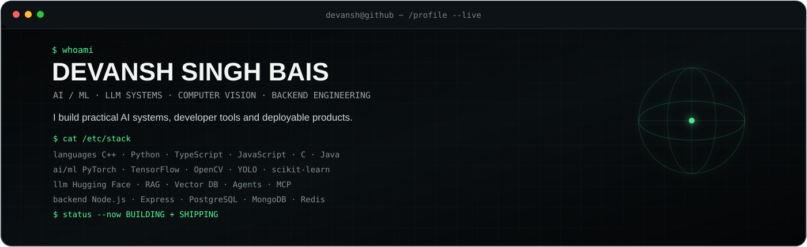

<div align="center">



<p>
<a href="https://github.com/DevanshSinghBais">GitHub</a> ·
<a href="https://www.linkedin.com/in/devansh-singh-bais-748b192b5/">LinkedIn</a> ·
<a href="mailto:devanshsinghbais111@gmail.com">Email</a>
</p>

</div>

```text
┌──[ devansh@github ]──[ ~/profile ]─────────────────────────────────────────┐
│                                                                            │
│  $ ./boot.sh                                                              │
│                                                                            │
│  [✓] AI / ML                 [✓] Backend Systems                          │
│  [✓] LLM Applications        [✓] Computer Vision                         │
│  [✓] Agentic AI              [✓] Production-minded Engineering            │
│                                                                            │
│  mission: turn models + tools + data into useful software.                │
│                                                                            │
└────────────────────────────────────────────────────────────────────────────┘
```

## `~/projects`

<table>
<tr>
<td width="50%" valign="top">

### `01` CrowdShield AI

**Computer vision for crowd safety.**

Multi-camera monitoring with detection, tracking, risk analysis, prediction and operational recommendations.

`YOLOv8` `ByteTrack` `OpenCV` `Node.js` `Express` `MongoDB` `React` `Docker`

<a href="https://github.com/DevanshSinghBais/CrowdSheild_Hackathon">↗ repository</a>

</td>
<td width="50%" valign="top">

### `02` EcoMRI

**Environmental intelligence platform.**

Turns environmental observations into anomalies, evidence, spatial context and recommended action.

`TypeScript` `React` `tRPC` `Express` `Drizzle`

<a href="https://github.com/DevanshSinghBais/ecomri">↗ repository</a> · <a href="https://ecomri-gsy3klvs.manus.space">↗ live</a>

</td>
</tr>
<tr>
<td width="50%" valign="top">

### `03` StudyPilot

**Tool-using AI learning agent.**

Routes questions to concrete tools for calculations, notes, study plans, quizzes and data analysis.

`Python` `LLM API` `Function Calling` `Gradio` `NumPy`

<a href="https://github.com/DevanshSinghBais/StudyPilot">↗ repository</a>

</td>
<td width="50%" valign="top">

### `04` GitHub Repo Explainer

**AI developer tooling.**

Fetches repository READMEs through the GitHub API and turns them into beginner-friendly explanations with Gemini.

`Python` `GitHub REST API` `Gemini` `Jupyter`

<a href="https://github.com/DevanshSinghBais/GitHub-Repo-Explainer">↗ repository</a>

</td>
</tr>
</table>

## `~/stack --all`

> **The complete toolbox — not just the 5 technologies shown by GitHub's language chart.**

| Domain | Stack |
|---|---|
| **Languages** | `C++` `Python` `C` `Java` `JavaScript` `TypeScript` `SQL` |
| **ML / DL** | `PyTorch` `TensorFlow` `scikit-learn` `NumPy` `Pandas` |
| **Computer Vision** | `OpenCV` `YOLO` `ByteTrack` `Image Processing` |
| **LLM / GenAI** | `Hugging Face` `Transformers` `RAG` `Vector DBs` `Prompt Engineering` `Function Calling` |
| **Agents** | `Agentic AI` `Tool Use` `MCP` `LLM Workflows` |
| **Backend** | `Node.js` `Express` `REST APIs` `tRPC` |
| **Databases** | `PostgreSQL` `MongoDB` `Redis` |
| **Frontend** | `React` `HTML` `CSS` |
| **DevOps / Systems** | `Docker` `Linux` `Git` `GitHub Actions` |
| **Data / Scientific** | `Pandas` `NumPy` `Matplotlib` `Jupyter` |

```text
$ stack --tree

AI
├── Machine Learning
│   ├── PyTorch
│   ├── TensorFlow / Keras
│   └── scikit-learn
├── Computer Vision
│   ├── OpenCV
│   ├── YOLO
│   └── ByteTrack
└── LLM Systems
    ├── Hugging Face / Transformers
    ├── RAG + Vector Databases
    ├── Function Calling
    ├── Agentic AI
    └── MCP

ENGINEERING
├── Backend → Node.js → Express → REST / tRPC
├── Data    → PostgreSQL → MongoDB → Redis
└── Infra   → Linux → Docker → Git → GitHub Actions
```

## `~/activity`

<div align="center">


<br/>


</div>

### contribution trail

<p align="center">

</p>

## `~/currently-building`

```text
┌────────────────────────────────────────────────────────────────────────────┐
│ ACTIVE                                                                      │
├────────────────────────────────────────────────────────────────────────────┤
│                                                                            │
│  > tool-using LLM workflows                                                │
│  > production-oriented AI backends                                         │
│  > computer-vision pipelines                                               │
│  > RAG + agentic systems                                                   │
│  > turning hackathon prototypes into deployable products                   │
│                                                                            │
└────────────────────────────────────────────────────────────────────────────┘
```

## `~/education`

**B.Tech. Computer Science & Engineering — MANIT Bhopal** · `2025–2029`

## `~/principles`

> **A model call is easy to make. A useful system makes its inputs, tools, failure modes and limits clear.**

```text
$ exit

Thanks for visiting.

devansh@github:~$ _
```
